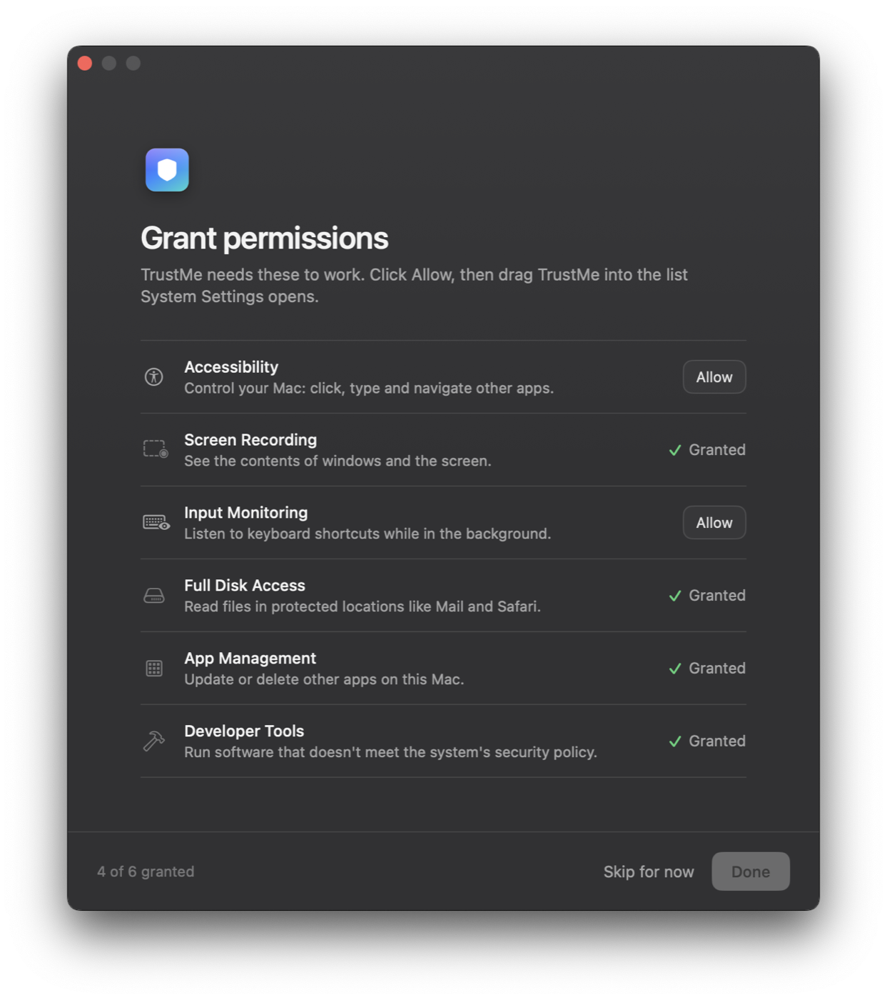
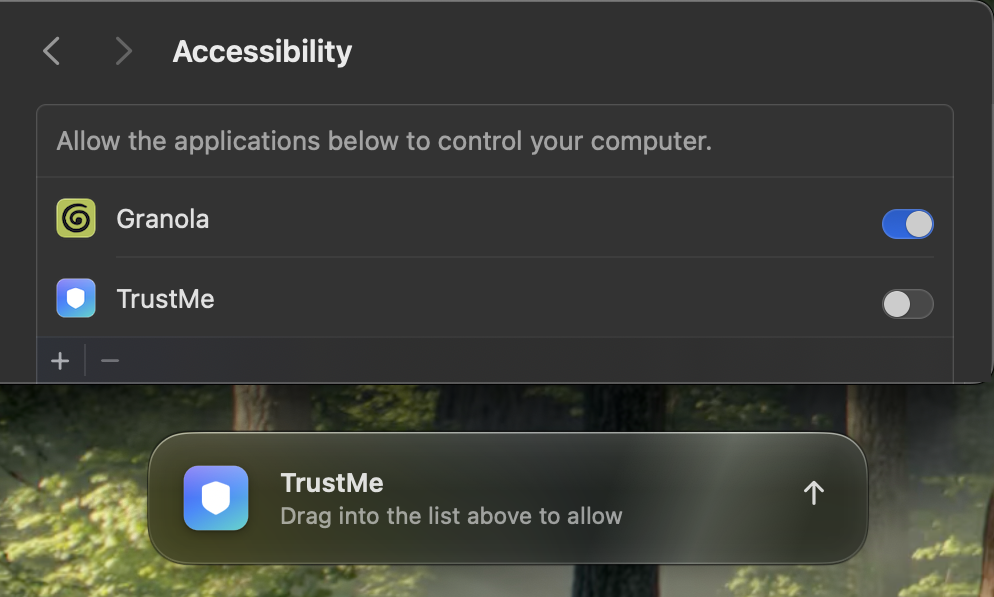

# TrustMe

TrustMe is a better UI for Mac apps to request permissions.

Instead of contending with ten separate setting popups provided by the main OS, manage
the whole flow in your own application. Tell TrustMe what permissions you need, and have it
present a beautiful window where users can drag and drop your app into their authorized
permissions list. No popups required.

<table>
  <tr>
    <td align="center" valign="middle" width="50%">
      
    </td>
    <td align="center" valign="middle" width="50%">
      
    </td>
  </tr>
  <tr>
    <td align="center"><b>1.</b> Your app lists what it needs. Click <b>Allow</b>.</td>
    <td align="center"><b>2.</b> Drag the band into the list. It switches to Granted on its own.</td>
  </tr>
</table>

- Floating panel docked to the System Settings window
- Requests auto dismiss with a success state once granted
- Customize permissions, only scoped to what you need
- Camera and Microphone in the same window, through the system's own prompt
- Auto detection of your app and design
- Beautiful glassy UI ready for macOS 26

## Getting started

TrustMe is a Swift package. It needs macOS 14 or later and Xcode 26 or later to build, since
the glass uses macOS 26 APIs where they're available.

### In an Xcode app project

1. **File › Add Package Dependencies…**
2. Paste `https://github.com/piercefreeman/TrustMe` into the search field.
3. Keep **Dependency Rule** at **Up to Next Major Version** from `0.1.0`, then **Add Package**.
4. Add the **TrustMe** library to your app target. Skip `TrustMeDemo`, which is the demo app.

### In a Package.swift

```swift
dependencies: [
    .package(url: "https://github.com/piercefreeman/TrustMe.git", from: "0.1.0"),
],
targets: [
    .executableTarget(
        name: "YourApp",
        dependencies: [.product(name: "TrustMe", package: "TrustMe")]
    ),
]
```

### Then

```swift
import TrustMe

PermissionsWindow.show([.accessibility, .screenRecording]) { allGranted in
    // continue onboarding
}
```

Things to know before shipping:

- **Run as a real `.app` bundle.** The bundle is what users drag into System Settings, so
  `swift run` of a bare executable has nothing meaningful to grant.
- **Sign with a stable identity.** macOS ties grants to the code signature. An ad-hoc signature
  changes on every build, so earlier grants quietly stop matching.
- **Describe Camera and Microphone use.** If you list `.camera` or `.microphone`, add
  `NSCameraUsageDescription` / `NSMicrophoneUsageDescription` to your Info.plist (macOS
  terminates apps that ask without them). With Hardened Runtime on, also add the
  `com.apple.security.device.camera` / `com.apple.security.device.audio-input` entitlements.
- **Distribute outside the Mac App Store.** Status detection uses TCC's private
  `TCCAccessPreflight` (see [Status detection](#status-detection)). TrustMe has only been
  tested in apps without App Sandbox.

## Usage

### Drop-in window

```swift
import TrustMe

// Lays itself out from the list: one row each, and a Continue button
// that unlocks once the required ones are granted. Mix drag-based and
// prompt-based (camera, microphone) permissions freely.
PermissionsWindow.show([.accessibility, .screenRecording], optional: [.fullDiskAccess]) { allGranted in
    startApp()
}
```

Customize with `title:`, `message:`, `continueTitle:`, `skipTitle:` (pass `nil` to hide)
and `showsAppIcon:`. `PermissionsView` is the same screen as a plain SwiftUI view, for
embedding in your own window.

### Build your own onboarding

```swift
VStack(spacing: 0) {
    PermissionRow(.accessibility)              // icon, title, live detail, action
    Hairline()
    PermissionRow(.screenRecording, detail: "So we can see what you see.")
    Hairline()
    HStack {
        Text("Your own copy")
        Spacer()
        PermissionButton(.inputMonitoring)     // Allow / Relaunch / Granted
    }
}
Button("Continue", action: next).buttonStyle(.trustMePrimary)   // also .trustMeSecondary, .trustMeLink
```

Or drive everything yourself:

```swift
PermissionFlow.shared.authorize(.screenRecording)   // opens Settings + the drag band
PermissionFlow.shared.authorize(.camera)            // system prompt, or its Settings pane once refused
PermissionCenter.shared.status(of: .accessibility)   // .granted / .needsRelaunch / .notGranted / .unknown
```

Custom permissions: `Permission(id:title:summary:systemImage:tint:settingsAnchor:check:)`.
Pass `canRequest:` and `request:` as well for one granted through a system prompt.

### Status detection

Statuses come from TCC's `TCCAccessPreflight` (private API, loaded dynamically), so
App Management and Developer Tools are readable and new grants show up immediately.
Without it, TrustMe falls back to public APIs (`AXIsProcessTrusted`,
`CGPreflightScreenCaptureAccess`, …) and reports `.unknown` where there's no public
check. The private call makes TrustMe unsuitable for the Mac App Store, which wouldn't
allow dragging apps into Privacy & Security lists anyway.

### Relaunching

Screen Recording and Input Monitoring only take effect after a relaunch. TrustMe reports
them as `.needsRelaunch`, and rows and the drag band offer a Relaunch button
(`Relauncher.relaunch()`). If System Settings quits the app itself ("Quit & Reopen"),
`Relauncher` reopens it, and `Relauncher.wasRelaunchedForPermissions` is `true` on that
launch so onboarding can resume.

## Demo

```sh
Scripts/build-demo.sh --open
```

The flow needs a real `.app` bundle (that's what gets dragged), so the script wraps the
SwiftPM binary into `build/TrustMe.app`. Use Demo › Reset All Permissions to replay
the flow. TCC ties grants to the code signature, so the script signs
with your first "Apple Development" identity (override with `CODESIGN_IDENTITY`). With
an ad-hoc signature every rebuild invalidates earlier grants, while System Settings keeps
showing the old entry switched on.

`--auto-request accessibility` starts a flow at launch.

The full-screen animations used for the demo videos (the popup storm and the scripted
drag) live in [`DemoVideos/`](DemoVideos/README.md):

```sh
Scripts/build-demo.sh
DemoVideos/popups.sh
DemoVideos/drag.sh
```

## Tests

```sh
swift test
```

Covers placement, status resolution, the fresh-process TCC probe, the relaunch flag and
view layout. CI runs them on a `macos-26` runner (the glass code needs the Xcode 26 SDK)
and builds the demo bundle.

## Design renders

`TrustMeRender` composites the real guide panel in every state (waiting, hover, dropped,
stalled, granted) over your wallpaper, a dark and a bright surface, beneath a capture of
the System Settings list, and screenshots the result:

```sh
screencapture -o -l <System Settings window id> settings.png
swift run TrustMeRender --settings settings.png --app build/TrustMe.app --out render.png
```

It briefly puts the composition on screen to capture it, since behind-window blur only
renders on screen.

## Credits

I first saw this interaction in OpenAI's Codex app, during its Computer Use setup, and
thought it was a great idea: instead of sending people hunting through System Settings,
hand them the app and let them drop it where it belongs. Ideally Apple supports this
first-class one day, or at least offers a less disruptive way to grant permissions. Until
then, it's up to the community to solve.
